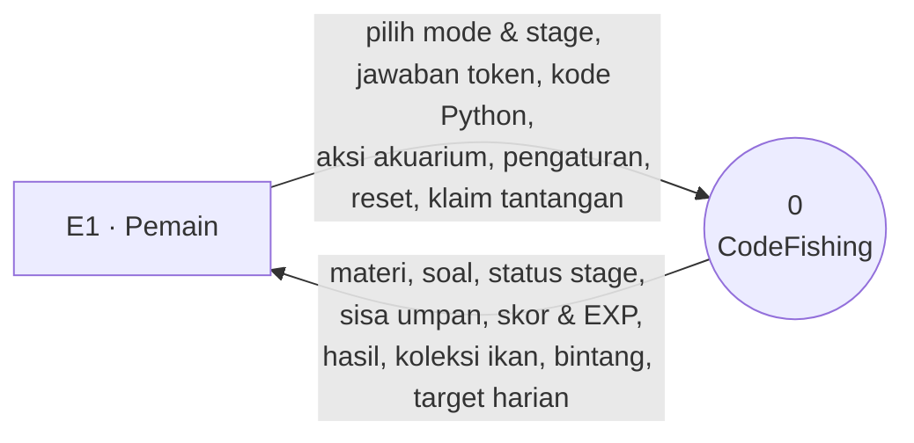
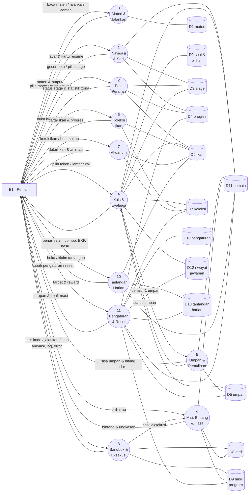
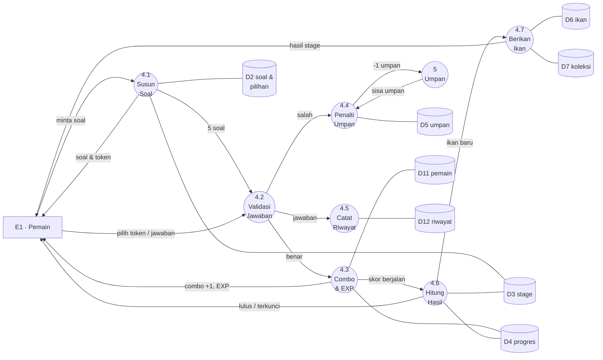
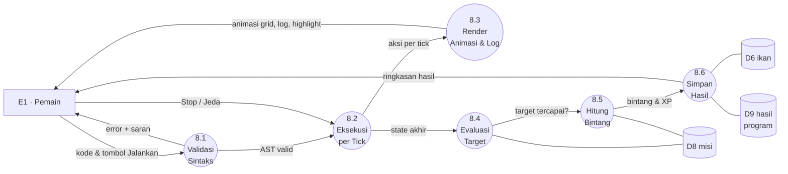
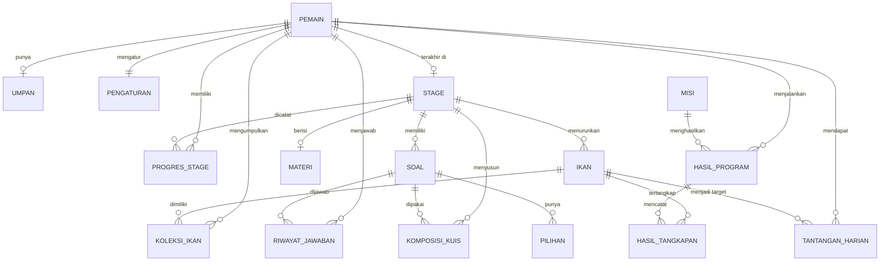

# CodeFishing — Rancangan DFD & Database

**Tahap MDLC:** Design (perancangan sistem)
**Kelompok 1 — PPBM**
**Versi:** 1.0 · 25 Oktober 2026
**Notasi DFD:** Yourdon / DeMarco
**Sumber:** `Presentasi_CodeFishing_4.pptx` (konsep & fitur), `CodeFishing_Design2.pptx` (storyboard, navigasi, 9 fitur A–I), Figma `CodeFishing` (`J6MgJV1zSvjwM1KUYJW4Pi`; page *2nd Attempt* sebagai acuan visual, page *1st Attempt* untuk layar fungsional).

---

## Daftar Isi

1. [Pendahuluan](#1-pendahuluan)
2. [Ruang Lingkup Sistem](#2-ruang-lingkup-sistem)
3. [Peta Fitur, Proses, dan Data Store](#3-peta-fitur-proses-dan-data-store)
4. [DFD (Yourdon/DeMarco)](#4-dfd-yourdondemarco)
5. [ERD & Skema Database](#5-erd--skema-database)
6. [Aturan Bisnis](#6-aturan-bisnis)
7. [Query Kunci](#7-query-kunci)
8. [Strategi Seed & Data Awal](#8-strategi-seed--data-awal)
9. [Validasi Silang: Layar Figma → Proses → Tabel](#9-validasi-silang-layar-figma--proses--tabel)
10. [Asumsi, Risiko, dan Keputusan Terbuka](#10-asumsi-risiko-dan-keputusan-terbuka)
11. [Kesimpulan & Serah Terima](#11-kesimpulan--serah-terima)
- [Lampiran A — DDL SQLite Lengkap](#lampiran-a--ddl-sqlite-lengkap)
- [Lampiran B — Pemetaan Istilah PPT vs Figma](#lampiran-b--pemetaan-istilah-ppt-vs-figma)

---

## 1. Pendahuluan

### 1.1 Posisi dokumen dalam MDLC

MDLC (Luther–Sutopo): **Concept → Design → Material Collecting → Assembly → Testing → Distribution**.

Tahap Design menghasilkan dua lapis artefak:

| Lapis | Artefak | Status |
|---|---|---|
| Visual & interaksi | logo, color palette, wireframe, storyboard, navigation structure, prototype | sudah ada di Figma & PPT |
| **Sistem** | **DFD, ERD, skema tabel, aturan bisnis, kontrak data** | **dokumen ini** |
| Perilaku | script aplikasi (teks layar, materi, soal, pesan) | sebagian di PPT |

Dokumen ini menjawab dua pertanyaan yang tidak dijawab artefak visual:

1. **DFD** — data apa yang masuk, diproses, dan keluar di setiap fungsi, serta di mana data disimpan.
2. **ERD + skema fisik** — bagaimana data itu dimodelkan menjadi tabel SQLite yang siap dipakai tahap Assembly.

### 1.2 Sumber dan batas perancangan

- **Fitur** diambil dari PPT (9 fitur A–I) dan navigation structure (siklus Belajar & Expert).
- **Layar** diambil dari Figma: 7 layar inti *2nd Attempt* + layar fungsional *1st Attempt*.
- **Mekanik** diambil dari Figma bila PPT tidak merinci (umpan, combo, EXP, tantangan harian).
- **Yang diabaikan:** aset gambar, warna, tipografi, dan layout piksel. Kolom `gambar` hanya menyimpan path aset.
- **Yang dikeluarkan dari MVP:** koin, kapal, jual ikan, galangan (konsep di board "Panduan UX statis" yang berlabel *belum terhubung*), serta "Pustaka Nelayan" (belum ada definisi).

### 1.3 Keputusan yang dikunci

| No | Aspek | Keputusan |
|---|---|---|
| K1 | Platform | Android native, offline, single-user, tanpa server |
| K2 | Penyimpanan | **SQLite/Room** untuk data pemain; **JSON di `assets/`** hanya untuk seed konten |
| K3 | Aktor | satu, yaitu **Pemain** |
| K4 | Soal | **5 soal per stage**; boss 5 soal gabungan (45 soal unik, 5 dipakai ulang di boss) |
| K5 | Kelulusan | skor ≥ **70%**; boss minimal **4 dari 5** benar |
| K6 | Umpan | maks 5, **+1 tiap 15 menit**, dihitung saat data dibaca |
| K7 | Tier ikan | 5: Biasa, Langka, Epik, Legenda, Mitos |
| K8 | Katalog ikan | 48 spesies (seed MVP 15–24, sisanya menyusul) |
| K9 | Navigasi | bottom nav 4 tab + drawer 5 item |
| K10 | Sandbox | tidak memakai umpan; satuan waktu = **tick**; 6 misi + mode Bebas |

### 1.4 Istilah

| Istilah | Arti di dokumen ini |
|---|---|
| Stage | Satu bab materi + kuis. Nomor 1–9, nomor 10 = Boss |
| Zona | Pengelompokan stage secara geografis (Epipelagik, Pelagik, Batial, Abisal) |
| Umpan | Nyawa kuis. Salah = −1. Pulih otomatis 1 per 15 menit |
| Umpan Emas | Reward tantangan harian; dapat ditukar 1:1 menjadi umpan reguler |
| Tick | Satuan waktu eksekusi Sandbox; 1 aksi = 1 tick (kecuali fungsi observasi) |
| Par | Target tick terbaik sebuah misi, dipakai menghitung bintang |
| Tier | Kelangkaan ikan; menentukan warna badge dan syarat unlock |
| Seed | Data konten read-only yang ditanam saat aplikasi pertama kali dibuka |

---

## 2. Ruang Lingkup Sistem

### 2.1 Aktor dan batas sistem

Sistem adalah **satu aplikasi Android** yang berjalan penuh di perangkat. Tidak ada autentikasi, tidak ada API, tidak ada sinkronisasi.

```
        +---------------------------------------------+
        |              CodeFishing (di HP)            |
Pemain  |  Belajar · Kuis · Koleksi · Akuarium        |
  O---->|  Sandbox · Misi · Tantangan Harian          |----> layar, suara, animasi
        |  Pengaturan · Reset                         |
        |                                             |
        |  SQLite lokal (16 tabel) + seed JSON        |
        +---------------------------------------------+
```

Konsekuensi untuk DFD:

- External entity hanya **Pemain**. Interpreter Python **bukan** entitas luar, melainkan sub-proses internal (8.2).
- Semua data store berada di dalam batas sistem (penyimpanan internal aplikasi).
- Tidak ada proses "login", "sinkronisasi", atau "admin".

### 2.2 Kebutuhan fungsional

| Kode | Fungsi | Fitur PPT | Proses |
|---|---|---|---|
| F-01 | Menjalankan aplikasi, memilih mode, membuka drawer, melanjutkan sesi terakhir | I | P1 |
| F-02 | Menampilkan peta perairan, status stage, statistik zona | A | P2 |
| F-03 | Menampilkan materi dan menjalankan contoh kode | B | P3 |
| F-04 | Kuis 5 soal berbasis token, combo, EXP, penalti umpan, hasil stage | B, C, E | P4 |
| F-05 | Mengelola sisa umpan dan pemulihan otomatis | C | P5 |
| F-06 | Menampilkan katalog 48 ikan, filter tier, status terkunci | D | P6 |
| F-07 | Akuarium interaktif: detail ikan, beri makan, status kenyang | H | P7 |
| F-08 | Sandbox: editor, eksekusi per tick, animasi, error, panel misi/fungsi | F | P8 |
| F-09 | Evaluasi misi, bintang 1–3, ringkasan hasil program | G | P9 |
| F-10 | Tantangan harian dan reward umpan emas | baru (Figma) | P10 |
| F-11 | Pengaturan audio/haptik/sintaks dan reset progres | I | P11 |

### 2.3 Kebutuhan non-fungsional yang memengaruhi data

| Aspek | Ketentuan | Dampak desain |
|---|---|---|
| Offline | 100% tanpa internet | tidak ada tabel/flow jaringan |
| Single-user | satu profil | `pemain` satu baris (`id = 1`), tetapi tetap memakai `pemain_id` |
| Ukuran | ±150–300 MB termasuk aset | data teks < 2 MB; sisa besar ada di aset |
| Daya tahan | app boleh ditutup kapan saja | semua status memakai timestamp, bukan timer di memori |
| Performa | daftar 48 ikan dan 45 soal unik | index pada kolom FK dan kolom pencarian |

---

## 3. Peta Fitur, Proses, dan Data Store

### 3.1 Fitur PPT → proses

| Fitur | Nama | Proses utama | Data store |
|---|---|---|---|
| A | Peta Perairan | P2 | D3, D4, D6 |
| B | Materi & Kuis | P3, P4 | D1, D2, D3, D4 |
| C | Umpan & Progres | P4, P5 | D5, D4 |
| D | Ikan & Koleksi | P6 | D6, D7 |
| E | Stage Boss | P2, P4 | D2, D3, D7 |
| F | Mode Expert (Sandbox) | P8 | D8, D9 |
| G | Misi & Bintang | P9 | D8, D9, D11 |
| H | Akuarium | P7 | D6, D7 |
| I | Fitur Pendukung | P1, P11 | D10, D11 |
| J | Tantangan Harian (Figma) | P10 | D13, D11 |

### 3.2 Daftar proses

| Proses | Nama | Fungsi ringkas |
|---|---|---|
| P1 | Navigasi & Sesi | routing layar, drawer, resume posisi terakhir |
| P2 | Peta Perairan | status 10 stage, statistik zona, gerbang boss |
| P3 | Materi & Jalankan Kode | materi, contoh kode, output/error sementara |
| P4 | Kuis & Evaluasi | 5 soal token, combo, EXP, penalti, hasil, boss |
| P5 | Umpan & Pemulihan | −1 saat salah, +1 tiap 15 menit, tukar umpan emas |
| P6 | Koleksi Ikan | katalog 48 ikan, filter tier, status abu-abu |
| P7 | Akuarium | detail ikan, animasi, beri makan, kenyang |
| P8 | Sandbox & Eksekusi Kode | editor, eksekusi tick, animasi, error |
| P9 | Misi, Bintang & Hasil | evaluasi target, bintang, ringkasan program |
| P10 | Tantangan Harian | target harian, reward umpan emas, kedaluwarsa |
| P11 | Pengaturan & Reset | audio, haptik, sintaks, reset progres |

### 3.3 Daftar data store

| Store | Nama logis | Isi | Tabel fisik |
|---|---|---|---|
| D1 | materi | materi per stage | `materi` |
| D2 | soal & pilihan | bank soal, opsi token, komposisi kuis | `soal`, `pilihan`, `komposisi_kuis` |
| D3 | stage | peta 9 stage + boss | `stage` |
| D4 | progres_stage | status, skor terbaik, combo, kelulusan | `progres_stage` |
| D5 | umpan | sisa, maksimum, jadwal pemulihan | `umpan` |
| D6 | ikan | katalog 48 spesies | `ikan` |
| D7 | koleksi_ikan | ikan dimiliki, bobot, level, kenyang | `koleksi_ikan` |
| D8 | misi | 6 misi + mode bebas, par tick | `misi` |
| D9 | hasil_program | hasil eksekusi sandbox + tangkapan | `hasil_program`, `hasil_tangkapan` |
| D10 | pengaturan | audio, haptik, sintaks, bahasa | `pengaturan` |
| D11 | pemain | profil, EXP, level, umpan emas, resume | `pemain` |
| D12 | riwayat_jawaban | audit jawaban kuis | `riwayat_jawaban` |
| D13 | tantangan_harian | target dan status harian | `tantangan_harian` |

---

## 4. DFD (Yourdon/DeMarco)

### 4.1 Notasi yang dipakai

| Simbol | Bentuk Yourdon/DeMarco | Pada diagram Mermaid |
|---|---|---|
| Entitas luar | persegi panjang | `["E1 · Pemain"]` |
| Proses | lingkaran | `(("4 · Kuis & Evaluasi"))` |
| Data store | dua garis sejajar | `[("D4 progres_stage")]` (silinder, pengganti) |
| Aliran data | panah berlabel | `-->\|"label"\|` |

Catatan: Mermaid tidak punya simbol "dua garis sejajar". Saat digambar ulang di draw.io/diagrams.net, ganti silinder menjadi simbol data store resmi. Nomor proses dan nomor store **tidak boleh berubah** antara diagram dan tabel.

Versi siap edit sudah tersedia: **`CodeFishing_DFD.drawio`** — 4 halaman (konteks, level 1, level 2 P4, level 2 P8). Di berkas itu data store sudah memakai simbol dua garis sejajar dan arah baca/tulis sudah diberi panah, jadi tidak perlu digambar ulang dari Mermaid.

Tingkat yang dipakai:

- **Diagram Konteks (Level 0):** satu proses "0 CodeFishing", satu entitas.
- **DFD Level 1:** dekomposisi menjadi P1–P11 dan D1–D13.
- **DFD Level 2:** hanya untuk P4 (Kuis) dan P8 (Sandbox), karena dua proses ini paling kompleks.
- P3, P5, P6, P7, P9, P10, P11 cukup Level 1 + spesifikasi proses.

### 4.2 Diagram Konteks (Level 0)



| Arah | Aliran | Struktur data |
|---|---|---|
| Masuk | pilih mode & stage | `id_mode` + `id_stage` |
| Masuk | jawaban kuis | `data_jawaban` |
| Masuk | kode program | `teks_kode` + `id_misi` |
| Masuk | aksi akuarium | `id_ikan` + `aksi` |
| Masuk | pengaturan | `data_pengaturan` |
| Masuk | reset progres | `konfirmasi_reset` |
| Masuk | klaim tantangan | `id_tantangan` |
| Keluar | materi & soal | `data_materi`, `data_soal` |
| Keluar | status stage | `data_stage` + status |
| Keluar | umpan | `data_umpan` |
| Keluar | skor, EXP, combo | `data_hasil_kuis` |
| Keluar | koleksi ikan | `data_koleksi[]` |
| Keluar | bintang & ringkasan | `data_hasil_program` |
| Keluar | target harian | `data_tantangan` |

### 4.3 DFD Level 1



Garis proses–store pada gambar di atas tidak berpanah agar tidak menjadi jaring ganda. **Arah baca/tulis dinyatakan di tabel 4.6**, dan itulah yang dipakai saat verifikasi. Saat digambar di draw.io, beri panah: proses → store untuk tulis, store → proses untuk baca, atau panah dua arah untuk baca-tulis.

### 4.4 DFD Level 2 — Proses 4 (Kuis & Evaluasi)



Alur varian **Boss (stage 10)** memakai sub-proses yang sama dengan dua perbedaan: 4.1 menyusun 5 soal gabungan dari stage 1–9, dan 4.6 memakai ambang 4/5 serta menaikkan tier ikan boss satu tingkat (maksimum Mitos) bila sempurna.

### 4.5 DFD Level 2 — Proses 8 (Sandbox & Eksekusi Kode)



Catatan: P8 **tidak** memakai umpan (sesuai Figma "No Bait Counter" dan PPT "Sandbox tidak memakai umpan"). Batas eksekusi 1.000 tick mencegah infinite loop.

### 4.6 Spesifikasi proses

#### 4.6.1 Proses Level 1

| Proses | Input | Output | Store (R/W) | Algoritma ringkas |
|---|---|---|---|---|
| **P1** Navigasi & Sesi | pilih mode, buka drawer, buka layar | layar tujuan, kartu "Terakhir Dimainkan", status tab | R: D3, D4, D11 · W: D11 | Baca profil; tentukan stage aktif (`stage_terakhir_id`, jika null pilih stage terbuka pertama); perbarui `terakhir_main`, `mode_terakhir`; render bottom nav/drawer |
| **P2** Peta Perairan | geser peta, pilih stage | status 10 stage, statistik zona, ringkasan stage | R: D3, D4, D6 | Status = `selesai` bila progres selesai; `aktif` bila prasyarat selesai; selain itu `terkunci`. Boss aktif bila stage 1–9 selesai. Persen zona = jumlah selesai / jumlah stage zona |
| **P3** Materi & Jalankan | pilih stage, jalankan contoh | materi, output/error sementara | R: D1 | Ambil materi; jalankan `contoh_kode` memakai interpreter yang sama dengan 8.2 dalam mode terbatas; output **tidak** disimpan |
| **P4** Kuis & Evaluasi | token/jawaban, lempar kail, lanjut | benar/salah, combo, EXP, skor, hasil stage | R: D2, D3, D5, D6, D11 · W: D4, D7, D11, D12 | Lihat 4.6.2. 5 soal; skor = benar/5×100; lulus ≥70; boss ≥4/5; sempurna → tier ikan boss naik satu tingkat |
| **P5** Umpan & Pemulihan | penalti, minta status, tukar emas | sisa umpan, countdown, status habis | R: D5, D11 · W: D5, D11 | Saat dibaca: jika `regen_at <= now`, tambah `((now - regen_at) / interval) + 1`, batasi `maks`; jika penuh `regen_at = null`. Tukar 1 umpan emas → 1 umpan |
| **P6** Koleksi Ikan | buka koleksi, filter tier | 48 kartu (berwarna/abu-abu), progres n/48, syarat | R: D6, D7 | `LEFT JOIN` katalog dengan koleksi; yang null dirender abu-abu + `syarat_unlock`; filter tier; urut tier lalu `urutan` |
| **P7** Akuarium | ketuk ikan, beri makan | detail ikan, animasi, status kenyang | R: D6, D7 · W: D7 | Hitung decay 5 poin/jam sejak `diperbarui_pada`; beri makan +25 (maks 100), set `terakhir_makan` dan `diperbarui_pada` |
| **P8** Sandbox & Eksekusi | kode, jalankan, stop, buka sheet | animasi, log, error + saran, hasil sementara | R: D8 · W: D9 | Lihat 4.6.2. Parse → eksekusi per tick → render → evaluasi; 1.000 tick maksimum |
| **P9** Misi & Bintang | pilih misi, hasil eksekusi | bintang 1–3, ringkasan waktu/ikan/XP, chip tangkapan | R: D8, D9, D6 · W: D9, D11 | `ticks <= par` → 3; `<= 1,5×par` → 2; selesai → 1; gagal/error → 0. XP misi ditambahkan ke profil |
| **P10** Tantangan Harian | buka, klaim | target hari ini, status, countdown 24 jam | R: D6, D13 · W: D13, D11 | Cek baris `(pemain_id, tanggal)`; jika belum ada, pilih ikan dari stage yang sudah selesai; `expires_at` = tengah malam berikutnya; klaim → `umpan_emas +1` |
| **P11** Pengaturan & Reset | toggle, reset | terapan audio/haptik/sintaks, konfirmasi | R/W: D10 · Reset: D4, D5, D7, D9, D11, D12, D13 | Simpan toggle; reset dalam satu transaksi (lihat BR-12), pengaturan tetap dipertahankan |

#### 4.6.2 Sub-proses Level 2

**P4 Kuis & Evaluasi**

| Sub | Nama | Input | Output | Store | Aturan |
|---|---|---|---|---|---|
| 4.1 | Susun Soal | `id_stage`, mode | 5 soal + pilihan | R D2, D3 | Ambil `komposisi_kuis` urut; boss memakai komposisi gabungan stage 1–9 |
| 4.2 | Validasi Jawaban | `id_soal`, `id_pilihan`/teks | benar / salah | R D2 | `tipe='token'` → `pilihan.benar=1`; `tipe='isi_kode'` → normalisasi spasi lalu bandingkan `jawaban_benar` |
| 4.3 | Combo & EXP | hasil validasi | combo baru, EXP | R/W D4, R/W D11 | Benar: combo +1, EXP +25; salah: combo 0 |
| 4.4 | Penalti Umpan | sinyal salah | sisa umpan | W D5 (via P5) | −1 umpan; bila 0 → tampilkan layar Umpan Habis |
| 4.5 | Catat Riwayat | jawaban | baris riwayat | W D12 | Simpan `pilihan_id`, `jawaban_teks`, `benar`, `combo_setelah`, `waktu` |
| 4.6 | Hitung Hasil | skor berjalan | lulus/tidak, skor akhir | R/W D3, D4 | Skor = benar/5×100; lulus ≥70; boss ≥4/5; set `status='selesai'` dan `lulus_pada` |
| 4.7 | Berikan Ikan | hasil lulus | ikan baru / update koleksi | R D6, W D7 | Ikan target stage masuk koleksi (`jumlah+1`); boss sempurna → `tier_didapat` naik satu tingkat (maks `mitos`) |

**P8 Sandbox & Eksekusi**

| Sub | Nama | Input | Output | Store | Aturan |
|---|---|---|---|---|---|
| 8.1 | Validasi Sintaks | teks kode | AST / error | — | Error sintaks → tampilkan baris + saran; arah salah (mis. `Timor`) → saran `Timur` (jarak Levenshtein ≤2) |
| 8.2 | Eksekusi per Tick | AST, state dunia | aksi & state baru | — | `gerak`/`lempar` = 1 tick; `lihat`, `get_x`, `get_y`, `ukuran`, `jumlah` = 0 tick; batas 1.000 tick |
| 8.3 | Render Animasi & Log | aksi | animasi grid, highlight baris, log terminal | — | Animasi tidak menghalangi evaluasi; log disimpan ke `output` |
| 8.4 | Evaluasi Target | state akhir | tercapai / tidak | R D8 | Target: jumlah ikan, baris tertentu, hindari sampah, penggunaan `def`, atau bebas |
| 8.5 | Hitung Bintang | ticks, par, status | bintang 1–3 | R D8 | Lihat BR-10 |
| 8.6 | Simpan Hasil | hasil + tangkapan | baris hasil & tangkapan | R D6, W D9 | Simpan `kode`, `output`, `error`, `ticks`, `bintang`, `xp`; tangkapan ke `hasil_tangkapan`; tambah `koleksi_ikan.jumlah` |

### 4.7 Kamus data

Notasi: `=` terdiri dari · `+` dan · `{ }` berulang · `[ ]` pilih salah satu · `( )` opsional.

| Nama | Struktur |
|---|---|
| `data_pemain` | `id_pemain + nama + xp + level + umpan_emas + (id_stage_terakhir) + (mode_terakhir) + dibuat_pada + terakhir_main` |
| `data_stage` | `id_stage + nomor + nama + zona + konsep + tipe + jumlah_soal + skor_lulus + xp_reward + (id_ikan_target) + urutan` |
| `data_materi` | `id_materi + id_stage + judul + isi_markdown + contoh_kode + output_contoh + trik_nelayan + urutan` |
| `data_soal` | `id_soal + id_stage_asal + tipe + teks + (kode_template) + (jawaban_benar) + pembahasan + poin + urutan + {data_pilihan}` |
| `data_pilihan` | `id_pilihan + teks + benar + urutan` |
| `data_jawaban` | `id_soal + (id_pilihan) + (jawaban_teks) + benar + combo_setelah` |
| `data_komposisi` | `id_stage + id_soal + urutan` |
| `data_progres` | `id_pemain + id_stage + status + skor_terbaik + combo_tertinggi + percobaan + (lulus_pada)` |
| `data_umpan` | `id_pemain + sisa + maks + interval_menit + (regen_at)` |
| `data_ikan` | `id_ikan + nama + (nama_ilmiah) + tier + konsep_python + deskripsi + (id_stage_asal) + syarat_unlock + nilai_xp + bobot_kg + gambar + urutan` |
| `data_koleksi` | `id_pemain + id_ikan + jumlah + bobot_terbesar + level + xp + kenyang + diperbarui_pada + pertama_didapat + (terakhir_makan)` |
| `data_misi` | `id_misi + nomor + judul + deskripsi + tipe + target_ikan + (target_baris) + par_tick + xp_reward + urutan` |
| `data_hasil` | `id_hasil + id_pemain + (id_misi) + kode + output + (error) + ticks + waktu_jalan_ms + bintang + xp + status + dibuat_pada + {data_tangkapan}` |
| `data_tangkapan` | `id_ikan + jumlah + bobot_kg` |
| `data_tantangan` | `id_tantangan + id_pemain + tanggal + id_ikan_target + reward_umpan_emas + status + expires_at` |
| `data_pengaturan` | `efek_suara + musik + haptik + pewarnaan_sintaks + bahasa` |

### 4.8 Balance check

**A. Aliran konteks harus muncul di Level 1**

| Aliran konteks | Proses penerima/pengirim |
|---|---|
| pilih mode & stage | P1, P2 |
| jawaban token | P4 |
| kode Python | P8 |
| aksi akuarium | P7 |
| pengaturan | P11 |
| reset | P11 |
| klaim tantangan | P10 |
| materi & soal | P3, P4 |
| status stage | P2 |
| sisa umpan | P5 |
| skor, EXP, combo | P4 |
| koleksi ikan | P6, P7 |
| bintang & ringkasan | P9 |
| target harian | P10 |

**B. Setiap store harus punya penulis dan pembaca**

| Store | Sumber awal | Ditulis oleh | Dibaca oleh |
|---|---|---|---|
| D1 materi | seed | — | P3 |
| D2 soal & pilihan | seed | — | P4 |
| D3 stage | seed | — | P1, P2, P4 |
| D4 progres | — | P4 | P1, P2, P4, P11 (hapus) |
| D5 umpan | inisialisasi | P5 | P4, P5, P11 (hapus) |
| D6 ikan | seed | — | P2, P4, P6, P7, P8, P10 |
| D7 koleksi | — | P4, P8 | P6, P7, P11 (hapus) |
| D8 misi | seed | — | P8, P9 |
| D9 hasil program | — | P8, P9 | P9, P11 (hapus) |
| D10 pengaturan | inisialisasi | P11 | P11 |
| D11 pemain | inisialisasi | P1, P4, P5, P9, P10, P11 | P1, P2, P4, P5, P11 |
| D12 riwayat jawaban | — | P4 | P4 (akurasi & review salah) |
| D13 tantangan harian | — | P10 | P10, P11 (hapus) |

Tidak ada store yang hanya ditulis tanpa dibaca, dan tidak ada store yang dibaca tanpa sumber. Ini syarat yang paling sering gagal saat DFD diperiksa.

---

## 5. ERD & Skema Database

### 5.1 ERD



Ada dua foreign key yang tidak digambar agar garis tidak bertumpuk, tetapi tetap ada di skema:

- `stage.ikan_target_id → ikan.id` (ikan hadiah stage)
- `ikan.asal_stage_id → stage.id` (stage asal spesies)

### 5.2 Relasi dan kardinalitas

| Dari | Ke | Kardinalitas | Aksi | Keterangan |
|---|---|---|---|---|
| `pemain.stage_terakhir_id` | `stage.id` | 0..1 : 1 | SET NULL | untuk kartu "Terakhir Dimainkan" |
| `stage.ikan_target_id` | `ikan.id` | 0..1 : 1 | SET NULL | hadiah stage; boss boleh berbeda |
| `materi.stage_id` | `stage.id` | 1 : 1 | CASCADE | satu stage satu materi (kecuali boss) |
| `soal.stage_asal_id` | `stage.id` | N : 1 | CASCADE | asal soal, bukan tempat dipakai |
| `pilihan.soal_id` | `soal.id` | N : 1 | CASCADE | 4 opsi token |
| `komposisi_kuis.stage_id` | `stage.id` | N : 1 | CASCADE | urutan soal per stage |
| `komposisi_kuis.soal_id` | `soal.id` | N : 1 | CASCADE | satu soal boleh dipakai di stage dan boss |
| `progres_stage.(pemain, stage)` | `pemain`, `stage` | N : 1 | CASCADE | unik per pasangan |
| `umpan.pemain_id` | `pemain.id` | 1 : 1 | CASCADE | satu baris umpan per pemain |
| `ikan.asal_stage_id` | `stage.id` | N : 1 | SET NULL | asal spesies |
| `koleksi_ikan.(pemain, ikan)` | `pemain`, `ikan` | N : 1 | CASCADE | unik per pasangan |
| `hasil_program.pemain_id` | `pemain.id` | N : 1 | CASCADE | riwayat run |
| `hasil_program.misi_id` | `misi.id` | N : 1 | SET NULL | selalu terisi; mode Bebas memakai baris misi nomor 7 |
| `hasil_tangkapan.hasil_id` | `hasil_program.id` | N : 1 | CASCADE | rincian ikan per run |
| `hasil_tangkapan.ikan_id` | `ikan.id` | N : 1 | RESTRICT | referensi katalog |
| `pengaturan.pemain_id` | `pemain.id` | 1 : 1 | CASCADE | satu baris |
| `riwayat_jawaban.(pemain, soal)` | `pemain`, `soal` | N : 1 | CASCADE | audit jawaban |
| `riwayat_jawaban.pilihan_id` | `pilihan.id` | N : 1 | SET NULL | null untuk tipe `isi_kode` |
| `tantangan_harian.(pemain, tanggal)` | `pemain` | N : 1 | CASCADE | unik per hari |
| `tantangan_harian.target_ikan_id` | `ikan.id` | N : 1 | RESTRICT | target harian |

### 5.3 Spesifikasi tabel

Tipe mengikuti SQLite: `INTEGER` untuk id, boolean (0/1), dan epoch milidetik; `TEXT` untuk teks; `REAL` untuk bobot.

#### 5.3.1 `pemain`

| Kolom | Tipe | Constraint / keterangan |
|---|---|---|
| `id` | INTEGER | PK, autoincrement; aplikasi memakai `id = 1` |
| `nama` | TEXT | NOT NULL, default `'Nakhoda Python'` |
| `xp` | INTEGER | NOT NULL, default 0; XP **di level berjalan**, bukan total |
| `level` | INTEGER | NOT NULL, default 1; ambang naik = `level × 100` |
| `umpan_emas` | INTEGER | NOT NULL, default 0; reward tantangan harian |
| `stage_terakhir_id` | INTEGER | FK `stage.id`, ON DELETE SET NULL |
| `mode_terakhir` | TEXT | CHECK `('belajar','expert','harian')` |
| `dibuat_pada` | INTEGER | NOT NULL, epoch ms |
| `terakhir_main` | INTEGER | NOT NULL, epoch ms |

Catatan: `total_skor`, `rank`, dan `combo_tertinggi` **tidak** disimpan di sini karena turunan. Lihat 5.5 dan 5.6.

#### 5.3.2 `stage`

| Kolom | Tipe | Constraint / keterangan |
|---|---|---|
| `id` | INTEGER | PK |
| `nomor` | INTEGER | NOT NULL, UNIQUE, CHECK 1–10 |
| `nama` | TEXT | NOT NULL; mis. `Variabel`, `String` |
| `zona` | TEXT | NOT NULL; Epipelagik / Pelagik / Batial / Abisal |
| `konsep` | TEXT | NOT NULL; konsep Python yang diajarkan |
| `tipe` | TEXT | NOT NULL, CHECK `('materi','boss')` |
| `jumlah_soal` | INTEGER | NOT NULL, default 5 |
| `skor_lulus` | INTEGER | NOT NULL, default 70 |
| `xp_reward` | INTEGER | NOT NULL, default 50 |
| `ikan_target_id` | INTEGER | FK `ikan.id`, ON DELETE SET NULL |
| `urutan` | INTEGER | NOT NULL; urutan tampil di peta |

#### 5.3.3 `materi`

| Kolom | Tipe | Constraint / keterangan |
|---|---|---|
| `id` | INTEGER | PK |
| `stage_id` | INTEGER | NOT NULL, UNIQUE, FK `stage.id` CASCADE |
| `judul` | TEXT | NOT NULL |
| `isi_markdown` | TEXT | NOT NULL; paragraf materi |
| `contoh_kode` | TEXT | NOT NULL; kode yang bisa dijalankan |
| `output_contoh` | TEXT | output yang diharapkan |
| `trik_nelayan` | TEXT | tips singkat (opsional) |
| `urutan` | INTEGER | NOT NULL, default 1 |

#### 5.3.4 `soal`

| Kolom | Tipe | Constraint / keterangan |
|---|---|---|
| `id` | INTEGER | PK |
| `stage_asal_id` | INTEGER | NOT NULL, FK `stage.id` CASCADE |
| `tipe` | TEXT | NOT NULL, CHECK `('token','isi_kode')` |
| `teks` | TEXT | NOT NULL; narasi soal |
| `kode_template` | TEXT | berisi `___` sebagai slot jawaban |
| `jawaban_benar` | TEXT | wajib untuk `isi_kode`; null untuk `token` |
| `pembahasan` | TEXT | NOT NULL; alasan jawaban |
| `poin` | INTEGER | NOT NULL, default 25 |
| `urutan` | INTEGER | NOT NULL |

CHECK tambahan: `tipe <> 'isi_kode' OR jawaban_benar IS NOT NULL`.

#### 5.3.5 `pilihan`

| Kolom | Tipe | Constraint / keterangan |
|---|---|---|
| `id` | INTEGER | PK |
| `soal_id` | INTEGER | NOT NULL, FK `soal.id` CASCADE |
| `teks` | TEXT | NOT NULL; mis. `print`, `echo`, `show`, `Print` |
| `benar` | INTEGER | NOT NULL, default 0, CHECK `(0,1)` |
| `urutan` | INTEGER | NOT NULL |
| — | — | UNIQUE `(soal_id, urutan)` |

Tepat satu `benar = 1` per soal dijaga di lapisan aplikasi (SQLite tidak punya partial unique lintas baris).

#### 5.3.6 `komposisi_kuis`

| Kolom | Tipe | Constraint / keterangan |
|---|---|---|
| `id` | INTEGER | PK |
| `stage_id` | INTEGER | NOT NULL, FK `stage.id` CASCADE |
| `soal_id` | INTEGER | NOT NULL, FK `soal.id` CASCADE |
| `urutan` | INTEGER | NOT NULL |
| — | — | UNIQUE `(stage_id, urutan)` dan UNIQUE `(stage_id, soal_id)` |

Tabel inilah yang membuat **soal boss tidak diduplikasi**. Stage 10 memakai 5 baris yang menunjuk soal dari stage 1–9.

#### 5.3.7 `progres_stage`

| Kolom | Tipe | Constraint / keterangan |
|---|---|---|
| `id` | INTEGER | PK |
| `pemain_id` | INTEGER | NOT NULL, FK `pemain.id` CASCADE |
| `stage_id` | INTEGER | NOT NULL, FK `stage.id` CASCADE |
| `status` | TEXT | NOT NULL, default `'terkunci'`, CHECK `('terkunci','aktif','selesai')` |
| `skor_terbaik` | INTEGER | NOT NULL, default 0 |
| `combo_tertinggi` | INTEGER | NOT NULL, default 0 |
| `percobaan` | INTEGER | NOT NULL, default 0 |
| `lulus_pada` | INTEGER | epoch ms, null bila belum lulus |
| — | — | UNIQUE `(pemain_id, stage_id)` |

#### 5.3.8 `umpan`

| Kolom | Tipe | Constraint / keterangan |
|---|---|---|
| `id` | INTEGER | PK |
| `pemain_id` | INTEGER | NOT NULL, UNIQUE, FK `pemain.id` CASCADE |
| `sisa` | INTEGER | NOT NULL, default 5, CHECK `sisa >= 0` |
| `maks` | INTEGER | NOT NULL, default 5 |
| `interval_menit` | INTEGER | NOT NULL, default 15 |
| `regen_at` | INTEGER | epoch ms kapan +1 berikutnya; null bila penuh |
| — | — | CHECK `(sisa <= maks)` |

#### 5.3.9 `ikan`

| Kolom | Tipe | Constraint / keterangan |
|---|---|---|
| `id` | INTEGER | PK |
| `nama` | TEXT | NOT NULL; mis. `Ikan Salmon Variabel` |
| `nama_ilmiah` | TEXT | mis. `Engraulidae pythonicus` |
| `tier` | TEXT | NOT NULL, CHECK `('biasa','langka','epik','legenda','mitos')` |
| `konsep_python` | TEXT | NOT NULL; mis. `String & Variabel` |
| `deskripsi` | TEXT | NOT NULL |
| `asal_stage_id` | INTEGER | FK `stage.id`, SET NULL |
| `syarat_unlock` | TEXT | ditampilkan saat ikan masih abu-abu |
| `nilai_xp` | INTEGER | NOT NULL, default 35 |
| `bobot_kg` | REAL | NOT NULL, default 1.0; bobot dasar tampilan |
| `gambar` | TEXT | path aset, mis. `ikan/salmon_variabel.png` |
| `urutan` | INTEGER | NOT NULL |

#### 5.3.10 `koleksi_ikan`

| Kolom | Tipe | Constraint / keterangan |
|---|---|---|
| `id` | INTEGER | PK |
| `pemain_id` | INTEGER | NOT NULL, FK `pemain.id` CASCADE |
| `ikan_id` | INTEGER | NOT NULL, FK `ikan.id` RESTRICT |
| `jumlah` | INTEGER | NOT NULL, default 1; bertambah tiap tangkapan |
| `bobot_terbesar` | REAL | NOT NULL, default 0 |
| `level` | INTEGER | NOT NULL, default 1; naik dari XP ikan |
| `tier_didapat` | TEXT | NOT NULL; default mengikuti `ikan.tier`, boss sempurna naik satu tingkat (maks `mitos`) |
| `xp` | INTEGER | NOT NULL, default 0 |
| `kenyang` | INTEGER | NOT NULL, default 100, CHECK 0–100 |
| `diperbarui_pada` | INTEGER | NOT NULL; basis decay kenyang |
| `pertama_didapat` | INTEGER | NOT NULL |
| `terakhir_makan` | INTEGER | null bila belum pernah diberi makan |
| — | — | UNIQUE `(pemain_id, ikan_id)` |

Catatan: `tier_didapat` **wajib diisi aplikasi** saat baris pertama kali dibuat (nilainya `ikan.tier`). Tidak ada `DEFAULT` di SQL karena nilainya bergantung pada baris `ikan`.

#### 5.3.11 `misi`

| Kolom | Tipe | Constraint / keterangan |
|---|---|---|
| `id` | INTEGER | PK |
| `nomor` | INTEGER | NOT NULL, UNIQUE, 1–6; baris Bebas memakai 7 |
| `judul` | TEXT | NOT NULL |
| `deskripsi` | TEXT | NOT NULL |
| `tipe` | TEXT | NOT NULL, CHECK `('misi','bebas')` |
| `target_ikan` | INTEGER | NOT NULL, default 0; 0 = tanpa target |
| `target_baris` | INTEGER | null bila tidak spesifik baris |
| `par_tick` | INTEGER | NOT NULL; dasar bintang 3 |
| `xp_reward` | INTEGER | NOT NULL, default 120 |
| `urutan` | INTEGER | NOT NULL |

#### 5.3.12 `hasil_program`

| Kolom | Tipe | Constraint / keterangan |
|---|---|---|
| `id` | INTEGER | PK |
| `pemain_id` | INTEGER | NOT NULL, FK `pemain.id` CASCADE |
| `misi_id` | INTEGER | FK `misi.id` SET NULL |
| `kode` | TEXT | NOT NULL; snapshot kode yang dijalankan |
| `output` | TEXT | log terminal |
| `error` | TEXT | null bila sukses |
| `ticks` | INTEGER | NOT NULL, default 0 |
| `waktu_jalan_ms` | INTEGER | NOT NULL, default 0 |
| `bintang` | INTEGER | NOT NULL, default 0, CHECK 0–3 |
| `xp` | INTEGER | NOT NULL, default 0 |
| `status` | TEXT | CHECK `('berjalan','selesai','error','dihentikan')` |
| `dibuat_pada` | INTEGER | NOT NULL |

#### 5.3.13 `hasil_tangkapan`

| Kolom | Tipe | Constraint / keterangan |
|---|---|---|
| `id` | INTEGER | PK |
| `hasil_id` | INTEGER | NOT NULL, FK `hasil_program.id` CASCADE |
| `ikan_id` | INTEGER | NOT NULL, FK `ikan.id` RESTRICT |
| `jumlah` | INTEGER | NOT NULL, default 1 |
| `bobot_kg` | REAL | NOT NULL, default 0 |

#### 5.3.14 `pengaturan`

| Kolom | Tipe | Constraint / keterangan |
|---|---|---|
| `id` | INTEGER | PK |
| `pemain_id` | INTEGER | NOT NULL, UNIQUE, FK `pemain.id` CASCADE |
| `efek_suara` | INTEGER | NOT NULL, default 1 |
| `musik` | INTEGER | NOT NULL, default 1 |
| `haptik` | INTEGER | NOT NULL, default 1 |
| `pewarnaan_sintaks` | INTEGER | NOT NULL, default 1 |
| `bahasa` | TEXT | NOT NULL, default `'id'` |

#### 5.3.15 `riwayat_jawaban`

| Kolom | Tipe | Constraint / keterangan |
|---|---|---|
| `id` | INTEGER | PK |
| `pemain_id` | INTEGER | NOT NULL, FK `pemain.id` CASCADE |
| `soal_id` | INTEGER | NOT NULL, FK `soal.id` CASCADE |
| `pilihan_id` | INTEGER | FK `pilihan.id` SET NULL |
| `jawaban_teks` | TEXT | untuk tipe `isi_kode` |
| `benar` | INTEGER | NOT NULL, CHECK `(0,1)` |
| `combo_setelah` | INTEGER | NOT NULL, default 0 |
| `waktu` | INTEGER | NOT NULL, epoch ms |

#### 5.3.16 `tantangan_harian`

| Kolom | Tipe | Constraint / keterangan |
|---|---|---|
| `id` | INTEGER | PK |
| `pemain_id` | INTEGER | NOT NULL, FK `pemain.id` CASCADE |
| `tanggal` | TEXT | NOT NULL, format `YYYY-MM-DD` waktu lokal |
| `target_ikan_id` | INTEGER | NOT NULL, FK `ikan.id` RESTRICT |
| `reward_umpan_emas` | INTEGER | NOT NULL, default 1 |
| `status` | TEXT | NOT NULL, CHECK `('tersedia','selesai','diklaim','kedaluwarsa')` |
| `expires_at` | INTEGER | NOT NULL, epoch ms tengah malam berikutnya |
| — | — | UNIQUE `(pemain_id, tanggal)` |

### 5.4 Index dan constraint

| Index | Tabel | Kolom | Alasan |
|---|---|---|---|
| `ux_stage_nomor` | `stage` | `nomor` | unik, pencarian stage |
| `ix_soal_stage` | `soal` | `stage_asal_id, urutan` | menyusun kuis |
| `ix_pilihan_soal` | `pilihan` | `soal_id, urutan` | render 4 token |
| `ux_komposisi_stage_soal` | `komposisi_kuis` | `stage_id, soal_id` | cegah soal ganda |
| `ix_progres_status` | `progres_stage` | `pemain_id, status` | unlock & statistik |
| `ix_ikan_tier` | `ikan` | `tier, urutan` | filter koleksi |
| `ix_koleksi_pemain` | `koleksi_ikan` | `pemain_id` | daftar akuarium |
| `ix_hasil_pemain` | `hasil_program` | `pemain_id, dibuat_pada DESC` | riwayat run |
| `ix_hasil_misi` | `hasil_program` | `misi_id, bintang` | bintang terbaik |
| `ix_tangkapan_hasil` | `hasil_tangkapan` | `hasil_id` | rincian run |
| `ix_riwayat_pemain` | `riwayat_jawaban` | `pemain_id, waktu DESC` | akurasi & review |
| `ux_tantangan_harian` | `tantangan_harian` | `pemain_id, tanggal` | satu target per hari |

Semua FK memakai `ON DELETE CASCADE` kecuali yang sengaja dipertahankan: `ikan` (RESTRICT) dan referensi opsional (`SET NULL`).

### 5.5 Normalisasi

| Bentuk | Bukti |
|---|---|
| **1NF** | Semua kolom atomik. Tidak ada kolom `pilihan_1..4`; opsi ada di tabel `pilihan`. Tidak ada kolom `ikan_1..n`; tangkapan ada di `hasil_tangkapan`. |
| **2NF** | Tidak ada dependensi parsial. Tabel penghubung (`komposisi_kuis`, `hasil_tangkapan`) memakai PK sendiri dan kunci unik pasangan, bukan PK gabungan yang menyimpan atribut. |
| **3NF** | Tidak ada dependensi transitif. Nama stage tidak disalin ke `progres_stage`; nama/tier ikan tidak disalin ke `koleksi_ikan`; `rank` dan `total_skor` tidak disimpan karena turunan dari `level` dan `SUM(skor_terbaik)`. |

Penyimpangan yang **disengaja** (bukan pelanggaran normalisasi, karena berupa state/fakta, bukan duplikasi):

| Kolom | Alasan |
|---|---|
| `koleksi_ikan.jumlah` | penghitung kumulatif tangkapan; sumbernya peristiwa yang tidak semuanya disimpan |
| `progres_stage.skor_terbaik` | rekor terbaik, bukan salinan skor terakhir |
| `umpan.sisa` | state berjalan yang harus tahan app ditutup |
| `koleksi_ikan.kenyang` | state akuarium dengan decay berbasis waktu |
| `hasil_program.xp` | snapshot XP saat run, agar riwayat tidak berubah saat rumus XP diubah |

### 5.6 View

```sql
CREATE VIEW v_koleksi_lengkap AS
SELECT
  i.id                           AS ikan_id,
  i.nama,
  i.tier                         AS tier_katalog,
  COALESCE(k.tier_didapat, i.tier) AS tier,
  i.konsep_python,
  i.gambar,
  i.syarat_unlock,
  COALESCE(k.jumlah, 0)          AS jumlah,
  COALESCE(k.bobot_terbesar, 0)  AS bobot_terbesar,
  COALESCE(k.level, 1)           AS level,
  COALESCE(k.kenyang, 100)       AS kenyang,
  CASE WHEN k.id IS NULL THEN 0 ELSE 1 END AS dimiliki
FROM ikan i
LEFT JOIN koleksi_ikan k
  ON k.ikan_id = i.id AND k.pemain_id = 1;
```

Kolom `tier` pada view adalah **tier efektif** (memakai `tier_didapat` bila ikan sudah dimiliki), sedangkan `tier_katalog` adalah tier asli katalog. Filter dan pengurutan tier di layar Koleksi memakai `tier`, sesuai BR-05.

```sql
CREATE VIEW v_statistik_pemain AS
SELECT
  p.id,
  p.nama,
  p.level,
  p.xp,
  p.level * 100 AS xp_target,
  (SELECT COALESCE(SUM(skor_terbaik), 0)
     FROM progres_stage WHERE pemain_id = p.id)                AS total_skor,
  (SELECT COUNT(*) FROM progres_stage
     WHERE pemain_id = p.id AND status = 'selesai')            AS stage_selesai,
  (SELECT COUNT(*) FROM koleksi_ikan WHERE pemain_id = p.id)   AS ikan_terkumpul,
  (SELECT COUNT(*) FROM ikan)                                  AS total_ikan,
  (SELECT COALESCE(SUM(mx), 0) FROM (
      SELECT MAX(bintang) AS mx FROM hasil_program
      WHERE pemain_id = p.id GROUP BY misi_id))                AS total_bintang
FROM pemain p;
```

---

## 6. Aturan Bisnis

Aturan bernomor ini yang dipakai saat implementasi dan saat pengujian. Jika ada konflik dengan Figma, aturan di sini yang menang (sesuai keputusan 1.3).

### BR-01 — Urutan dan kunci stage

1. Stage 1 selalu terbuka.
2. Stage *n* (2–9) terbuka bila stage *n−1* berstatus `selesai`.
3. Boss (stage 10) terbuka bila stage 1–9 semuanya `selesai`.
4. Status tidak disimpan sebagai kolom di `stage`; dihitung dari `progres_stage` (lihat 7.2).
5. Menyelesaikan stage yang sudah selesai hanya memperbarui `skor_terbaik` bila skor baru lebih tinggi.

### BR-02 — Kuis

| Aturan | Nilai |
|---|---|
| Jumlah soal per stage | 5 (dari `komposisi_kuis`) |
| Jawaban benar | EXP +25, combo +1 |
| Jawaban salah | combo = 0, umpan −1 |
| Skor stage | `benar / 5 × 100` |
| Batas lulus | ≥ 70 (minimal 4 benar) |
| Boss | 5 soal gabungan, lulus ≥ 4/5 |
| Boss sempurna | 5/5 → `tier_didapat` ikan boss naik satu tingkat (maks `mitos`) |
| Percobaan | `percobaan +1` setiap mulai kuis |
| Skor terbaik | `MAX(skor_terbaik, skor_baru)` |

### BR-03 — EXP, level, dan rank

EXP masuk ke `pemain.xp` (XP level berjalan). Ambang naik level = `level × 100`.

```
tambahXP(gain):
  xp = xp + gain
  selama xp >= level * 100:
      xp = xp - level * 100
      level = level + 1
```

| Sumber EXP | Nilai |
|---|---|
| Jawaban benar | +25 |
| Lulus stage | +50 |
| Menyelesaikan misi | +120 |
| Menjalankan contoh materi | +5 |

| Level | Rank |
|---|---|
| 1 | Pemancing Pemula |
| 2 | Nelayan Sintaks *(asumsi)* |
| 3 | Palung Python |
| 4 | Nakhoda Python |
| 5 | Kapten Algoritma |
| 6+ | Legenda Samudra *(asumsi)* |

Rank **tidak disimpan**; dihitung dari `level` melalui pemetaan konstan di aplikasi.

### BR-04 — Umpan

1. Maksimum 5, awal 5.
2. Pemulihan **+1 setiap 15 menit**, bukan pengisian penuh.
3. Pemulihan dihitung saat data dibaca (app boleh ditutup), memakai `regen_at`.
4. Jawaban salah = −1. Jika sisa 0, kuis diblokir dan layar **Umpan Habis** ditampilkan.
5. Materi, peta, koleksi, akuarium, dan Sandbox **tidak** memakai umpan.
6. Umpan Emas dapat ditukar **1:1** menjadi umpan reguler dari layar Umpan Habis *(asumsi desain, karena Figma hanya menampilkan reward tanpa aturan tukar)*.
7. Menyelesaikan soal yang sudah dijawab tetap tersimpan walau umpan habis (sesuai teks Figma).

### BR-05 — Koleksi ikan

1. Stage selesai → ikan target stage masuk koleksi: `jumlah +1`, `bobot_terbesar = MAX(lama, bobot_baru)`.
2. Bobot tangkapan = `ikan.bobot_kg × acak(0,85–1,25)`, dibulatkan 1 desimal.
3. Boss sempurna → `koleksi_ikan.tier_didapat` naik satu tingkat dari `ikan.tier`, maksimum `mitos` (tier per pemain, bukan mengubah katalog).
4. Katalog selalu menampilkan **48 ikan**. Yang belum dimiliki dirender abu-abu dengan `syarat_unlock`.
5. Filter tier memakai `tier_didapat` bila ada, selain itu `ikan.tier`.

### BR-06 — Akuarium

1. `kenyang` 0–100, awal 100.
2. Turun 5 poin per jam, dihitung dari `diperbarui_pada` saat layar dibuka.
3. Beri makan: `kenyang = MIN(100, kenyang + 25)`, set `terakhir_makan` dan `diperbarui_pada`.
4. Beri makan tidak memakai umpan dan tidak dibatasi cooldown.
5. Detail ikan menampilkan tier, konsep Python, bobot terbesar, level, XP, dan asal stage.

### BR-07 — Sandbox dan misi

1. Misi terdiri dari 6 misi + 1 mode **Bebas** (nomor 7).
2. Misi *n* terbuka bila misi *n−1* punya hasil dengan `bintang > 0`. Misi 1 selalu terbuka.
3. Sandbox tidak memakai umpan dan tidak memengaruhi progres stage.
4. Eksekusi dibatasi 1.000 tick; lebih dari itu dihentikan dengan status `dihentikan`.
5. Setiap run disimpan di `hasil_program`, termasuk yang error, agar pemain bisa membandingkan.

### BR-08 — Fungsi Sandbox dan biaya tick

| Fungsi | Efek | Biaya |
|---|---|---|
| `gerak(arah)` | pindah 1 petak (Utara/Timur/Selatan/Barat) | 1 tick |
| `lempar()` | tangkap ikan di petak perahu | 1 tick |
| `lihat(arah)` | kembalikan `'ikan'`, `'sampah'`, atau `None` | 0 tick |
| `get_x()`, `get_y()` | koordinat perahu (0–4) | 0 tick |
| `ukuran()` | dimensi grid | 0 tick |
| `jumlah()` | sisa target ikan | 0 tick |

Arah **case-sensitive**. `Timor` → error + saran `Timur`.

### BR-09 — Penanganan error Sandbox

1. Error sintaks → tampilkan baris, jenis error, dan saran.
2. Error runtime → tampilkan `traceback` ringkas, misi tetap bisa dijalankan ulang.
3. Error tidak mengurangi umpan dan tidak menghapus checkpoint misi.

### BR-10 — Bintang

```
bintang(ticks, par, selesai, error):
  jika error atau tidak selesai -> 0
  jika ticks <= par            -> 3
  jika ticks <= 1.5 * par      -> 2
  lainnya                      -> 1
```

Bintang misi yang ditampilkan = `MAX(bintang)` dari seluruh run misi tersebut.

### BR-11 — Tantangan harian

1. Satu tantangan per `(pemain, tanggal lokal)`, kedaluwarsa tengah malam.
2. Target dipilih dari ikan yang stage-nya sudah selesai.
3. Reward = 1 Umpan Emas, diklaim manual.
4. Status: `tersedia → selesai → diklaim`; jika lewat tengah malam → `kedaluwarsa`.
5. Tantangan tidak memakai umpan.

### BR-12 — Reset progres

Satu transaksi, pengaturan **tidak** dihapus:

```sql
DELETE FROM progres_stage;
DELETE FROM koleksi_ikan;
DELETE FROM hasil_program;      -- hasil_tangkapan ikut CASCADE
DELETE FROM riwayat_jawaban;
DELETE FROM tantangan_harian;
UPDATE umpan   SET sisa = maks, regen_at = NULL;
UPDATE pemain  SET xp = 0, level = 1, umpan_emas = 0,
                   stage_terakhir_id = NULL, mode_terakhir = NULL;
```

### BR-13 — Penyimpanan dan offline

1. Tidak ada sinkronisasi cloud. Menu "Sinkronisasi Cloud" pada layar lama **tidak dipakai**.
2. Seed konten (`stage`, `materi`, `soal`, `pilihan`, `komposisi_kuis`, `ikan`, `misi`) bersifat read-only dan ditanam saat pertama kali database dibuat.
3. Data pemain tidak pernah dikirim ke luar perangkat.
4. Semua waktu disimpan sebagai epoch milidetik, bukan string tanggal, kecuali `tantangan_harian.tanggal`.

### BR-14 — Angka kanonik

| Besaran | Nilai |
|---|---|
| Stage | 10 (9 materi + 1 boss) |
| Soal | 5 per stage; 45 soal unik + 5 soal dipakai ulang di boss |
| Ikan | 48 spesies, 5 tier |
| Misi | 6 + Bebas |
| Umpan | maks 5, +1 / 15 menit |
| Batas lulus | 70%; boss 4/5 |
| Bintang | 0–3 |
| Batas tick | 1.000 |
| Level | ambang `level × 100` |

---

## 7. Query Kunci

Semua contoh memakai `pemain_id = 1` (single-user). Di Room, query ditulis sebagai `@Query` pada DAO.

### 7.1 Koleksi lengkap (termasuk ikan abu-abu)

```sql
SELECT *
FROM v_koleksi_lengkap
WHERE (:tier IS NULL OR tier = :tier)
ORDER BY CASE tier
           WHEN 'mitos'   THEN 0
           WHEN 'legenda' THEN 1
           WHEN 'epik'    THEN 2
           WHEN 'langka'  THEN 3
           ELSE 4
         END,
         ikan_id;
```

### 7.2 Status dan kunci stage

```sql
SELECT
  s.*,
  CASE
    WHEN s.nomor = 1 THEN 1
    WHEN s.tipe = 'boss' THEN (
      SELECT CASE WHEN COUNT(*) = 9 THEN 1 ELSE 0 END
      FROM progres_stage p
      JOIN stage st ON st.id = p.stage_id
      WHERE p.pemain_id = :pemain
        AND p.status = 'selesai'
        AND st.nomor BETWEEN 1 AND 9
    )
    ELSE (
      SELECT CASE WHEN COUNT(*) = 1 THEN 1 ELSE 0 END
      FROM progres_stage p
      JOIN stage st ON st.id = p.stage_id
      WHERE p.pemain_id = :pemain
        AND p.status = 'selesai'
        AND st.nomor = s.nomor - 1
    )
  END AS terbuka
FROM stage s
ORDER BY s.nomor;
```

### 7.3 Pemulihan umpan (dihitung saat dibaca)

```kotlin
@Transaction
fun muatUmpan(now: Long): Umpan {
    val u = umpanDao.get(pemainId) ?: return umpanDao.buatDefault(pemainId)
    if (u.sisa >= u.maks || u.regenAt == null || now < u.regenAt) return u

    val interval = u.intervalMenit * 60_000L
    val tambah = ((now - u.regenAt) / interval + 1).toInt()
    val sisaBaru = minOf(u.maks, u.sisa + tambah)
    val regenBaru = if (sisaBaru >= u.maks) null
                    else u.regenAt + tambah * interval

    return u.copy(sisa = sisaBaru, regenAt = regenBaru)
        .also { umpanDao.update(it) }
}
```

Saat jawaban salah: `sisa = sisa - 1`; bila `sisa` menjadi 0 dan `regenAt` null, set `regenAt = now + interval`.

### 7.4 Naik level

```kotlin
fun tambahXp(p: Pemain, gain: Int): Pemain {
    var xp = p.xp + gain
    var level = p.level
    while (xp >= level * 100) {
        xp -= level * 100
        level += 1
    }
    return p.copy(xp = xp, level = level)
}
```

### 7.5 Bintang terbaik per misi

```sql
SELECT
  m.id,
  m.judul,
  m.par_tick,
  COALESCE(MAX(h.bintang), 0) AS bintang,
  CASE WHEN COALESCE(MAX(h.bintang), 0) > 0 THEN 1 ELSE 0 END AS selesai
FROM misi m
LEFT JOIN hasil_program h
  ON h.misi_id = m.id AND h.pemain_id = :pemain
GROUP BY m.id
ORDER BY m.urutan;
```

Kunci misi dihitung di aplikasi: misi 1 selalu terbuka; misi *n* terbuka bila baris *n−1* punya `selesai = 1`.

### 7.6 Tantangan hari ini

```sql
SELECT * FROM tantangan_harian
WHERE pemain_id = :pemain AND tanggal = :hari;
```

Bila tidak ada, aplikasi memilih satu ikan dari stage yang sudah selesai, lalu `INSERT` dengan `expires_at` = tengah malam berikutnya.

### 7.7 Ringkasan Beranda

```sql
SELECT * FROM v_statistik_pemain WHERE id = 1;
```

---

## 8. Strategi Seed & Data Awal

### 8.1 Prinsip

| Jenis data | Cara masuk | Boleh diubah pemain |
|---|---|---|
| Konten (stage, materi, soal, pilihan, komposisi, ikan, misi) | JSON di `assets/seed/`, ditanam saat database pertama dibuat | tidak |
| Profil & pengaturan | dibuat oleh aplikasi saat pertama dibuka | ya |
| Progres, umpan, koleksi, hasil, riwayat, tantangan | dibuat oleh permainan | ya |

Seed **tidak** ditimpa saat update aplikasi, kecuali versi seed naik. Kolom versi disimpan di `pengaturan` atau `SharedPreferences` (`seed_version`).

### 8.2 Berkas seed

| Berkas | Isi | Perkiraan baris |
|---|---|---|
| `stage.json` | 10 stage | 10 |
| `materi.json` | 9 materi (stage 1–9) | 9 |
| `soal.json` | 45 soal + pilihan bersarang | 45 |
| `komposisi_kuis.json` | 45 soal stage + 5 soal boss | 50 |
| `ikan.json` | 48 spesies | 48 |
| `misi.json` | 6 misi + Bebas | 7 |

### 8.3 Urutan penanaman

1. `stage` dengan `ikan_target_id = NULL` (karena `ikan` belum ada).
2. `ikan`.
3. `UPDATE stage SET ikan_target_id = ...` dari `ikan.json`.
4. `materi`.
5. `soal` lalu `pilihan` (satu transaksi).
6. `komposisi_kuis`.
7. `misi`.
8. Buat `pemain (id=1)`, `umpan`, `pengaturan`.

Semua langkah dalam satu transaksi. Jika gagal, database dihapus dan dibuat ulang saat pembukaan berikutnya.

### 8.4 Contoh `stage.json` dan `ikan.json`

```json
{
  "stage": [
    {
      "id": 1,
      "nomor": 1,
      "nama": "Variabel",
      "zona": "Epipelagik",
      "konsep": "Variabel & assignment",
      "tipe": "materi",
      "jumlah_soal": 5,
      "skor_lulus": 70,
      "xp_reward": 50,
      "ikan_target_id": 1,
      "urutan": 1
    }
  ],
  "ikan": [
    {
      "id": 1,
      "nama": "Ikan Salmon Variabel",
      "nama_ilmiah": "Salmo variabilis",
      "tier": "langka",
      "konsep_python": "String & Variabel",
      "asal_stage_id": 1,
      "syarat_unlock": "Selesaikan Stage 1",
      "nilai_xp": 35,
      "bobot_kg": 1.2,
      "gambar": "ikan/salmon_variabel.png",
      "urutan": 1
    }
  ]
}
```

### 8.5 Contoh `soal.json`

```json
{
  "id": 1,
  "stage_asal_id": 1,
  "tipe": "token",
  "teks": "Kapten menampilkan salam di layar kapal. Lengkapi perintah untuk menampilkan teks!",
  "kode_template": "___(\"Hello\")",
  "pembahasan": "print() adalah fungsi bawaan Python untuk menampilkan teks.",
  "poin": 25,
  "urutan": 1,
  "pilihan": [
    { "teks": "print", "benar": 1, "urutan": 1 },
    { "teks": "echo",  "benar": 0, "urutan": 2 },
    { "teks": "show",  "benar": 0, "urutan": 3 },
    { "teks": "Print", "benar": 0, "urutan": 4 }
  ]
}
```

### 8.6 Rancangan isi konten

| Stage | Nama | Zona | Konsep | Ikan hadiah | Tier |
|---|---|---|---|---|---|
| 1 | Variabel | Epipelagik | assignment, `print()` | Ikan Salmon Variabel | langka |
| 2 | String | Epipelagik | string, kutip, konkatenasi | Cumi String | langka |
| 3 | Nama Variabel | Epipelagik | aturan penamaan, case | Guppy Cetak | biasa |
| 4 | List | Pelagik | index, `append` | Pari Array | langka |
| 5 | Loop | Pelagik | `for`, `while`, `range` | Tuna Loop | biasa |
| 6 | Fungsi | Pelagik | `def`, `return`, parameter | Kerapu Fungsi | biasa |
| 7 | Kondisi | Batial | `if`, `elif`, `else` | Pufferfish Boolean | biasa |
| 8 | Dictionary | Batial | key-value, `get` | Marlin Dictionary | epik |
| 9 | List Comprehension | Abisal | comprehension, filter | Hiu List Comp | epik |
| 10 | Boss: Samudra Pasifik | Abisal | gabungan 1–9 | Kraken Metaclass | legenda |

Nama stage 6–9 adalah **usulan** yang diturunkan dari nama ikan dan konsep di Figma; belum ada di layar. Ganti bila dosen/konten final berbeda.

### 8.7 Validasi seed

| Pemeriksaan | Nilai benar |
|---|---|
| Jumlah `stage` | 10 |
| Jumlah `materi` | 9 |
| Jumlah `soal` unik | 45 |
| Jumlah `pilihan` | 180 (45 × 4) |
| Jumlah `komposisi_kuis` | 50 (45 stage + 5 boss) |
| Setiap stage materi punya 5 komposisi | ya |
| Stage 10 punya 5 komposisi | ya |
| Setiap soal tipe `token` punya tepat 1 `benar = 1` | ya |
| Setiap soal tipe `isi_kode` punya `jawaban_benar` | ya |
| Soal boss adalah soal stage 1–9 yang dipakai ulang, bukan baris baru | ya |
| Jumlah `ikan` | 48 |
| Jumlah `misi` | 7 |

---

## 9. Validasi Silang: Layar Figma → Proses → Tabel

Tabel ini adalah uji kelengkapan: **setiap elemen yang tampil harus punya sumber data, dan setiap aksi harus punya efek tulis**. Jika ada baris tanpa tabel, berarti ada fitur yang belum dirancang.

| No | Layar (Figma) | Proses | Tabel dibaca | Tabel ditulis |
|---|---|---|---|---|
| 1 | Landing Page / splash | P1 | `pemain` | — |
| 2 | Beranda (`UI · BERANDA`) | P1 | `pemain`, `progres_stage`, `stage`, `umpan` | `pemain` |
| 3 | Pilih Mode (`UI · MODE BELAJAR`) | P1 | `stage`, `progres_stage`, `tantangan_harian` | — |
| 4 | Drawer | P1 | `pemain` | — |
| 5 | Peta Perairan (`PILIH PETA`) | P2 | `stage`, `progres_stage`, `ikan` | — |
| 6 | Detail Paket (statistik zona) | P2 | `stage`, `progres_stage` | — |
| 7 | Overview Zona (materi + jalankan) | P3 | `materi` | — |
| 8 | Soal Kode (`QUIZ`, select/right/wrong) | P4 | `komposisi_kuis`, `soal`, `pilihan`, `umpan`, `progres_stage` | `progres_stage`, `umpan`, `riwayat_jawaban`, `pemain` |
| 9 | Hasil Tangkapan (overlay) | P4 | `ikan`, `koleksi_ikan` | `koleksi_ikan` |
| 10 | Stage Selesai | P4 | `progres_stage`, `ikan`, `koleksi_ikan` | `progres_stage` |
| 11 | Umpan Habis | P5 | `umpan`, `pemain` | `umpan`, `pemain` |
| 12 | Stage Boss | P2, P4 | `stage`, `progres_stage`, `ikan` | `progres_stage` |
| 13 | Koleksi (`UI · KOLEKSI`) | P6 | `v_koleksi_lengkap` | — |
| 14 | Akuarium | P7 | `ikan`, `koleksi_ikan` | `koleksi_ikan` |
| 15 | Sandbox (idle/running/selesai/error) | P8 | `misi`, `ikan` | `hasil_program` |
| 16 | Sheet Misi | P9 | `misi`, `hasil_program` | — |
| 17 | Sheet Fungsi | P8 | — | — |
| 18 | Hasil Program | P9 | `misi`, `hasil_program`, `hasil_tangkapan` | `hasil_program`, `pemain` |
| 19 | Pengaturan | P11 | `pengaturan`, `pemain` | `pengaturan` |
| 20 | Reset Progres | P11 | `pemain`, `koleksi_ikan` | `progres_stage`, `umpan`, `koleksi_ikan`, `hasil_program`, `riwayat_jawaban`, `tantangan_harian`, `pemain` |
| 21 | Tantangan Harian (card) | P10 | `ikan`, `tantangan_harian` | `tantangan_harian`, `pemain` |
| 22 | Pustaka Nelayan | — | — | — (di luar MVP) |

### 9.1 Ketidaksesuaian Figma yang sudah diputuskan

| Temuan | Di Figma | Keputusan dokumen |
|---|---|---|
| Jumlah soal | 2, 5, 8, dan 10 muncul di layar berbeda | **5** per stage |
| Jumlah ikan | 48 (Koleksi), 15 (mockup HTML), 39 aset (PPT) | **48** katalog, seed MVP 15–24 |
| Tier | 4 filter, 5 badge, 1 mockup | **5** tier |
| Penyimpanan | "JSON Database" dan "SQLite Local DB" | **SQLite + seed JSON** |
| Umpan | reset penuh vs +1 per 15 menit | **+1 per 15 menit** |
| Cloud sync | ada di layar lama | **dihapus**, offline murni |
| Koin, kapal, jual ikan | ada di board "Panduan UX statis" | **di luar MVP** |
| Navigasi | drawer (PPT) vs bottom nav (Figma) | **keduanya**, bottom nav untuk 4 tujuan utama |

---

## 10. Asumsi, Risiko, dan Keputusan Terbuka

### 10.1 Asumsi

| Kode | Asumsi | Dampak bila salah |
|---|---|---|
| A1 | Nama stage 6–9: Fungsi, Kondisi, Dictionary, List Comprehension | judul materi/seed berubah; struktur tidak |
| A2 | Dari 48 ikan, baru 21 yang punya nama; sisanya diisi saat Material Collecting | katalog dan filter tetap valid |
| A3 | `par_tick` misi 1, 3–6 belum final; hanya misi 2 = 14 | perhitungan bintang berubah |
| A4 | Umpan Emas ditukar 1:1 menjadi umpan reguler | bila tidak, `umpan_emas` hanya koleksi |
| A5 | Kenyang turun 5 poin/jam, beri makan +25 | angka akuarium berubah |
| A6 | Rank level 2, 4, 6: Nelayan Sintaks, Nakhoda Python, Legenda Samudra | hanya label |
| A7 | Boss sempurna menaikkan tier satu tingkat (Legenda → Mitos) | reward boss berubah |
| A8 | EXP: 25 benar, 50 lulus, 120 misi, 5 materi | kurva level berubah |
| A9 | Tantangan harian memilih target acak dari stage selesai | target harian bisa berbeda |
| A10 | Pustaka Nelayan tidak masuk MVP | satu layar tidak dibuat |

### 10.2 Risiko

| Kode | Risiko | Mitigasi |
|---|---|---|
| R1 | Volume konten: 45 soal + 48 ilustrasi ikan | seed bertahap; 15 ikan untuk MVP, sisanya menyusul |
| R2 | Interpreter Python mini bisa melebar | batasi 7 fungsi, 1.000 tick, tanpa import/IO |
| R3 | Keseimbangan `par_tick` | uji main 5 kali per misi, ambil median + 20% |
| R4 | Perubahan seed merusak progres | `seed_version`; reset hanya bila versi naik dan pemain setuju |
| R5 | `pemain_id = 1` tersebar di query | simpan sebagai konstanta `CURRENT_PLAYER` |
| R6 | Figma dan PPT masih berbeda | dokumen ini menjadi acuan; perubahan harus lewat revisi BR |

### 10.3 Keputusan yang masih terbuka

1. Judul final stage 6–9.
2. Daftar 48 ikan dan pembagian tier.
3. `par_tick` misi 1 dan 3–6.
4. Apakah tangkapan Sandbox masuk koleksi (dokumen ini: **ya**, `koleksi_ikan.jumlah +1`).
5. Apakah "Pustaka Nelayan" dibuat pada rilis berikutnya.

---

## 11. Kesimpulan & Serah Terima

### 11.1 Yang dihasilkan tahap Design

| Artefak | Jumlah |
|---|---|
| Diagram DFD | 4 (konteks, level 1, level 2 P4, level 2 P8) |
| Proses | 11 level 1 + 13 sub-proses |
| Data store | 13 |
| Tabel | 16 + 2 view |
| Aturan bisnis | 14 |
| Layar tervalidasi | 22 baris (21 layar + 1 non-MVP) |

### 11.2 Berkas pendamping

| Berkas | Isi | Dipakai pada |
|---|---|---|
| `CodeFishing_DFD_ERD.md` | dokumen ini (DFD, ERD, aturan bisnis, seed) | semua tahap |
| `CodeFishing_DFD.drawio` | 4 diagram DFD siap edit di draw.io/diagrams.net (notasi Yourdon/DeMarco, data store sudah memakai simbol dua garis sejajar) | sidang, laporan, revisi diagram |
| `schema.sql` | DDL SQLite siap jalan (`sqlite3 codefishing.db < schema.sql`) | Assembly (Room) & Testing |

### 11.3 Serah terima ke tahap berikutnya

| Tahap | Yang harus disiapkan | Mengacu ke |
|---|---|---|
| Material Collecting | 196 PNG, 48 ilustrasi ikan, audio, isi 45 soal, JSON seed | 8.2–8.6 |
| Assembly | Room + DAO, Compose, interpreter 7 fungsi | 5.3, 5.4, 7 |
| Testing | uji BR-01…BR-14, validasi seed 8.7, uji offline & app ditutup | 6, 8.7 |
| Distribution | APK, tanpa izin internet | 2.3 |

### 11.4 Checklist sebelum sidang

- [ ] Setiap proses di DFD Level 1 punya spesifikasi (4.6).
- [ ] Setiap store punya penulis dan pembaca (4.8).
- [ ] Setiap FK punya index (5.4).
- [ ] Setiap layar punya sumber data (9).
- [ ] Tidak ada entitas Admin/Server/Login.
- [ ] Angka kanonik di layar = BR-14.
- [ ] Asumsi A1–A10 disetujui kelompok.

---

## Lampiran A — DDL SQLite Lengkap

Skrip ini bisa langsung dijalankan di SQLite/Room (Room memakai anotasi entity, tetapi DDL ini adalah kontrak final). Urutan pembuatan penting karena ada referensi melingkar `stage ↔ ikan`.

Berkas siap jalan: **`schema.sql`** (folder yang sama). Isinya identik dengan blok di bawah, ditambah komentar header dan contoh inisialisasi profil.

```sql
PRAGMA foreign_keys = ON;

-- ============================================================
-- 1. KONTEN (read-only, di-seed dari assets/seed/*.json)
-- ============================================================

CREATE TABLE stage (
  id             INTEGER PRIMARY KEY AUTOINCREMENT,
  nomor          INTEGER NOT NULL UNIQUE CHECK (nomor BETWEEN 1 AND 10),
  nama           TEXT    NOT NULL,
  zona           TEXT    NOT NULL,
  konsep         TEXT    NOT NULL,
  tipe           TEXT    NOT NULL CHECK (tipe IN ('materi','boss')),
  jumlah_soal    INTEGER NOT NULL DEFAULT 5 CHECK (jumlah_soal > 0),
  skor_lulus     INTEGER NOT NULL DEFAULT 70 CHECK (skor_lulus BETWEEN 0 AND 100),
  xp_reward      INTEGER NOT NULL DEFAULT 50 CHECK (xp_reward >= 0),
  ikan_target_id INTEGER REFERENCES ikan(id) ON DELETE SET NULL,
  urutan         INTEGER NOT NULL
);

CREATE TABLE ikan (
  id            INTEGER PRIMARY KEY AUTOINCREMENT,
  nama          TEXT    NOT NULL,
  nama_ilmiah   TEXT,
  tier          TEXT    NOT NULL CHECK (tier IN ('biasa','langka','epik','legenda','mitos')),
  konsep_python TEXT    NOT NULL,
  deskripsi     TEXT    NOT NULL,
  asal_stage_id INTEGER REFERENCES stage(id) ON DELETE SET NULL,
  syarat_unlock TEXT,
  nilai_xp      INTEGER NOT NULL DEFAULT 35 CHECK (nilai_xp >= 0),
  bobot_kg      REAL    NOT NULL DEFAULT 1.0 CHECK (bobot_kg > 0),
  gambar        TEXT,
  urutan        INTEGER NOT NULL
);

CREATE TABLE materi (
  id            INTEGER PRIMARY KEY AUTOINCREMENT,
  stage_id      INTEGER NOT NULL UNIQUE REFERENCES stage(id) ON DELETE CASCADE,
  judul         TEXT    NOT NULL,
  isi_markdown  TEXT    NOT NULL,
  contoh_kode   TEXT    NOT NULL,
  output_contoh TEXT,
  trik_nelayan  TEXT,
  urutan        INTEGER NOT NULL DEFAULT 1
);

CREATE TABLE soal (
  id             INTEGER PRIMARY KEY AUTOINCREMENT,
  stage_asal_id  INTEGER NOT NULL REFERENCES stage(id) ON DELETE CASCADE,
  tipe           TEXT    NOT NULL CHECK (tipe IN ('token','isi_kode')),
  teks           TEXT    NOT NULL,
  kode_template  TEXT,
  jawaban_benar  TEXT,
  pembahasan     TEXT    NOT NULL,
  poin           INTEGER NOT NULL DEFAULT 25 CHECK (poin > 0),
  urutan         INTEGER NOT NULL,
  CHECK (tipe <> 'isi_kode' OR jawaban_benar IS NOT NULL)
);

CREATE TABLE pilihan (
  id       INTEGER PRIMARY KEY AUTOINCREMENT,
  soal_id  INTEGER NOT NULL REFERENCES soal(id) ON DELETE CASCADE,
  teks     TEXT    NOT NULL,
  benar    INTEGER NOT NULL DEFAULT 0 CHECK (benar IN (0,1)),
  urutan   INTEGER NOT NULL,
  UNIQUE (soal_id, urutan)
);

CREATE TABLE komposisi_kuis (
  id       INTEGER PRIMARY KEY AUTOINCREMENT,
  stage_id INTEGER NOT NULL REFERENCES stage(id) ON DELETE CASCADE,
  soal_id  INTEGER NOT NULL REFERENCES soal(id) ON DELETE CASCADE,
  urutan   INTEGER NOT NULL,
  UNIQUE (stage_id, urutan),
  UNIQUE (stage_id, soal_id)
);

CREATE TABLE misi (
  id           INTEGER PRIMARY KEY AUTOINCREMENT,
  nomor        INTEGER NOT NULL UNIQUE,
  judul        TEXT    NOT NULL,
  deskripsi    TEXT    NOT NULL,
  tipe         TEXT    NOT NULL CHECK (tipe IN ('misi','bebas')),
  target_ikan  INTEGER NOT NULL DEFAULT 0 CHECK (target_ikan >= 0),
  target_baris INTEGER,
  par_tick     INTEGER NOT NULL CHECK (par_tick > 0),
  xp_reward    INTEGER NOT NULL DEFAULT 120 CHECK (xp_reward >= 0),
  urutan       INTEGER NOT NULL
);

-- ============================================================
-- 2. DATA PEMAIN (mutable)
-- ============================================================

CREATE TABLE pemain (
  id                INTEGER PRIMARY KEY AUTOINCREMENT,
  nama              TEXT    NOT NULL DEFAULT 'Nakhoda Python',
  xp                INTEGER NOT NULL DEFAULT 0 CHECK (xp >= 0),
  level             INTEGER NOT NULL DEFAULT 1 CHECK (level >= 1),
  umpan_emas        INTEGER NOT NULL DEFAULT 0 CHECK (umpan_emas >= 0),
  stage_terakhir_id INTEGER REFERENCES stage(id) ON DELETE SET NULL,
  mode_terakhir     TEXT    CHECK (mode_terakhir IN ('belajar','expert','harian')),
  dibuat_pada       INTEGER NOT NULL,
  terakhir_main     INTEGER NOT NULL
);

CREATE TABLE progres_stage (
  id               INTEGER PRIMARY KEY AUTOINCREMENT,
  pemain_id        INTEGER NOT NULL REFERENCES pemain(id) ON DELETE CASCADE,
  stage_id         INTEGER NOT NULL REFERENCES stage(id) ON DELETE CASCADE,
  status           TEXT    NOT NULL DEFAULT 'terkunci'
                   CHECK (status IN ('terkunci','aktif','selesai')),
  skor_terbaik     INTEGER NOT NULL DEFAULT 0 CHECK (skor_terbaik BETWEEN 0 AND 100),
  combo_tertinggi  INTEGER NOT NULL DEFAULT 0 CHECK (combo_tertinggi >= 0),
  percobaan        INTEGER NOT NULL DEFAULT 0 CHECK (percobaan >= 0),
  lulus_pada       INTEGER,
  UNIQUE (pemain_id, stage_id)
);

CREATE TABLE umpan (
  id             INTEGER PRIMARY KEY AUTOINCREMENT,
  pemain_id      INTEGER NOT NULL UNIQUE REFERENCES pemain(id) ON DELETE CASCADE,
  sisa           INTEGER NOT NULL DEFAULT 5 CHECK (sisa >= 0),
  maks           INTEGER NOT NULL DEFAULT 5 CHECK (maks > 0),
  interval_menit INTEGER NOT NULL DEFAULT 15 CHECK (interval_menit > 0),
  regen_at       INTEGER,
  CHECK (sisa <= maks)
);

CREATE TABLE koleksi_ikan (
  id               INTEGER PRIMARY KEY AUTOINCREMENT,
  pemain_id        INTEGER NOT NULL REFERENCES pemain(id) ON DELETE CASCADE,
  ikan_id          INTEGER NOT NULL REFERENCES ikan(id) ON DELETE RESTRICT,
  jumlah           INTEGER NOT NULL DEFAULT 1 CHECK (jumlah >= 0),
  bobot_terbesar   REAL    NOT NULL DEFAULT 0 CHECK (bobot_terbesar >= 0),
  level            INTEGER NOT NULL DEFAULT 1 CHECK (level >= 1),
  tier_didapat     TEXT    NOT NULL
                   CHECK (tier_didapat IN ('biasa','langka','epik','legenda','mitos')),
  xp               INTEGER NOT NULL DEFAULT 0 CHECK (xp >= 0),
  kenyang          INTEGER NOT NULL DEFAULT 100 CHECK (kenyang BETWEEN 0 AND 100),
  diperbarui_pada  INTEGER NOT NULL,
  pertama_didapat  INTEGER NOT NULL,
  terakhir_makan   INTEGER,
  UNIQUE (pemain_id, ikan_id)
);

CREATE TABLE hasil_program (
  id             INTEGER PRIMARY KEY AUTOINCREMENT,
  pemain_id      INTEGER NOT NULL REFERENCES pemain(id) ON DELETE CASCADE,
  misi_id        INTEGER REFERENCES misi(id) ON DELETE SET NULL,
  kode           TEXT    NOT NULL,
  output         TEXT    NOT NULL DEFAULT '',
  error          TEXT,
  ticks          INTEGER NOT NULL DEFAULT 0 CHECK (ticks >= 0),
  waktu_jalan_ms INTEGER NOT NULL DEFAULT 0 CHECK (waktu_jalan_ms >= 0),
  bintang        INTEGER NOT NULL DEFAULT 0 CHECK (bintang BETWEEN 0 AND 3),
  xp             INTEGER NOT NULL DEFAULT 0 CHECK (xp >= 0),
  status         TEXT    NOT NULL
                 CHECK (status IN ('berjalan','selesai','error','dihentikan')),
  dibuat_pada    INTEGER NOT NULL
);

CREATE TABLE hasil_tangkapan (
  id       INTEGER PRIMARY KEY AUTOINCREMENT,
  hasil_id INTEGER NOT NULL REFERENCES hasil_program(id) ON DELETE CASCADE,
  ikan_id  INTEGER NOT NULL REFERENCES ikan(id) ON DELETE RESTRICT,
  jumlah   INTEGER NOT NULL DEFAULT 1 CHECK (jumlah > 0),
  bobot_kg REAL    NOT NULL DEFAULT 0 CHECK (bobot_kg >= 0)
);

CREATE TABLE pengaturan (
  id                INTEGER PRIMARY KEY AUTOINCREMENT,
  pemain_id         INTEGER NOT NULL UNIQUE REFERENCES pemain(id) ON DELETE CASCADE,
  efek_suara        INTEGER NOT NULL DEFAULT 1 CHECK (efek_suara IN (0,1)),
  musik             INTEGER NOT NULL DEFAULT 1 CHECK (musik IN (0,1)),
  haptik            INTEGER NOT NULL DEFAULT 1 CHECK (haptik IN (0,1)),
  pewarnaan_sintaks INTEGER NOT NULL DEFAULT 1 CHECK (pewarnaan_sintaks IN (0,1)),
  bahasa            TEXT    NOT NULL DEFAULT 'id'
);

CREATE TABLE riwayat_jawaban (
  id             INTEGER PRIMARY KEY AUTOINCREMENT,
  pemain_id      INTEGER NOT NULL REFERENCES pemain(id) ON DELETE CASCADE,
  soal_id        INTEGER NOT NULL REFERENCES soal(id) ON DELETE CASCADE,
  pilihan_id     INTEGER REFERENCES pilihan(id) ON DELETE SET NULL,
  jawaban_teks   TEXT,
  benar          INTEGER NOT NULL CHECK (benar IN (0,1)),
  combo_setelah  INTEGER NOT NULL DEFAULT 0 CHECK (combo_setelah >= 0),
  waktu          INTEGER NOT NULL
);

CREATE TABLE tantangan_harian (
  id                INTEGER PRIMARY KEY AUTOINCREMENT,
  pemain_id         INTEGER NOT NULL REFERENCES pemain(id) ON DELETE CASCADE,
  tanggal           TEXT    NOT NULL,
  target_ikan_id    INTEGER NOT NULL REFERENCES ikan(id) ON DELETE RESTRICT,
  reward_umpan_emas INTEGER NOT NULL DEFAULT 1 CHECK (reward_umpan_emas >= 0),
  status            TEXT    NOT NULL
                    CHECK (status IN ('tersedia','selesai','diklaim','kedaluwarsa')),
  expires_at        INTEGER NOT NULL,
  UNIQUE (pemain_id, tanggal)
);

-- ============================================================
-- 3. INDEX TAMBAHAN
-- ============================================================

CREATE INDEX ix_stage_zona      ON stage(zona, nomor);
CREATE INDEX ix_soal_stage      ON soal(stage_asal_id, urutan);
CREATE INDEX ix_pilihan_soal    ON pilihan(soal_id, urutan);
CREATE INDEX ix_progres_status  ON progres_stage(pemain_id, status);
CREATE INDEX ix_ikan_tier       ON ikan(tier, urutan);
CREATE INDEX ix_koleksi_pemain  ON koleksi_ikan(pemain_id);
CREATE INDEX ix_hasil_pemain    ON hasil_program(pemain_id, dibuat_pada DESC);
CREATE INDEX ix_hasil_misi      ON hasil_program(misi_id, bintang);
CREATE INDEX ix_tangkapan_hasil ON hasil_tangkapan(hasil_id);
CREATE INDEX ix_riwayat_pemain  ON riwayat_jawaban(pemain_id, waktu DESC);

-- ============================================================
-- 4. VIEW
-- ============================================================

CREATE VIEW v_koleksi_lengkap AS
SELECT
  i.id                           AS ikan_id,
  i.nama,
  i.tier                         AS tier_katalog,
  COALESCE(k.tier_didapat, i.tier) AS tier,
  i.konsep_python,
  i.gambar,
  i.syarat_unlock,
  COALESCE(k.jumlah, 0)          AS jumlah,
  COALESCE(k.bobot_terbesar, 0)  AS bobot_terbesar,
  COALESCE(k.level, 1)           AS level,
  COALESCE(k.kenyang, 100)       AS kenyang,
  CASE WHEN k.id IS NULL THEN 0 ELSE 1 END AS dimiliki
FROM ikan i
LEFT JOIN koleksi_ikan k
  ON k.ikan_id = i.id AND k.pemain_id = 1;

CREATE VIEW v_statistik_pemain AS
SELECT
  p.id,
  p.nama,
  p.level,
  p.xp,
  p.level * 100 AS xp_target,
  (SELECT COALESCE(SUM(skor_terbaik), 0)
     FROM progres_stage WHERE pemain_id = p.id)                AS total_skor,
  (SELECT COUNT(*) FROM progres_stage
     WHERE pemain_id = p.id AND status = 'selesai')            AS stage_selesai,
  (SELECT COUNT(*) FROM koleksi_ikan WHERE pemain_id = p.id)   AS ikan_terkumpul,
  (SELECT COUNT(*) FROM ikan)                                  AS total_ikan,
  (SELECT COALESCE(SUM(mx), 0) FROM (
      SELECT MAX(bintang) AS mx FROM hasil_program
      WHERE pemain_id = p.id GROUP BY misi_id))                AS total_bintang
FROM pemain p;
```

Catatan implementasi Room:

1. `stage` dan `ikan` saling merujuk. Room memerlukan `@ForeignKey` dengan `deferred = true` pada salah satu sisi, atau seed dua tahap seperti 8.3.
2. `v_koleksi_lengkap` memakai `pemain_id = 1` konstan. Bila kelak multi-profil, ganti dengan parameter.
3. `tantangan_harian.tanggal` disimpan sebagai teks `YYYY-MM-DD` karena dipakai untuk pencarian per hari; kolom waktu lain memakai epoch ms.
4. Semua boolean disimpan `INTEGER 0/1` agar konsisten dengan SQLite.

---

## Lampiran B — Pemetaan Istilah PPT vs Figma

| Istilah PPT | Istilah Figma | Catatan |
|---|---|---|
| Home | Beranda | bottom nav tab 1 |
| Pilih Mode | Mode Belajar / Pilih Mode | berisi Belajar, Expert, Tantangan Harian |
| Peta Perairan | PILIH PETA | peta zona + 10 stage |
| Materi | Overview Zona | materi + contoh kode yang bisa dijalankan |
| Kuis | Soal Kode / QUIZ | 4 state: awal, pilih, benar, salah |
| Hasil Stage | Stage Selesai + Hasil Tangkapan | skor, EXP, ikan, akuarium |
| Umpan Habis | 11 Umpan Habis | countdown, lanjut kuis, kembali |
| Stage Boss | 12 Stage Boss | briefing 5 soal, aturan, bonus Epic |
| Koleksi | Koleksi / AKUARIUM (judul layar) | grid 48 ikan + filter tier |
| Akuarium | Akuarium (mockup) | ikan berenang, detail, beri makan |
| Sandbox | 07 Sandbox (+ Running, Selesai, Error) | editor + grid + panel misi/fungsi |
| Misi | Sheet Misi | 6 misi + Bebas |
| Hasil Program | Hasil Program / Misi Selesai | bintang, waktu, tangkapan, XP |
| Pengaturan | 10 Pengaturan | audio, haptik, sintaks, reset |
| Drawer | Menu | 5 item, termasuk Pustaka Nelayan |

Perbedaan penamaan ini **tidak** mengubah model data; hanya label di layar. Dokumen ini memakai istilah PPT untuk proses, dan istilah Figma untuk verifikasi layar.

---

*Dokumen ini adalah artefak tahap Design MDLC. Perubahan pada DFD, ERD, atau aturan bisnis harus disertai revisi nomor versi agar tahap Assembly tidak memakai spesifikasi ganda.*

